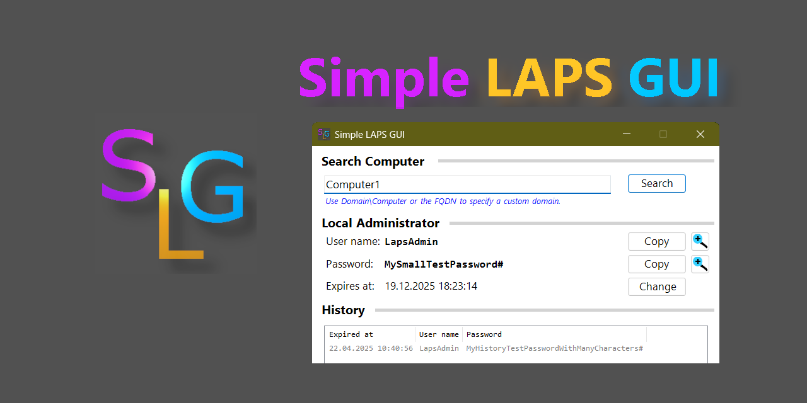

# Simple LAPS GUI  

<!-- Name des Repositories muss immer klein geschrieben werden. -->
  

   

  

A simple and fast GUI for Microsoft LAPS (legacy) and Windows LAPS. With this tool you can query passwords and change the expiration timestamp.

## Features

- Simple and fast: Run the PowerShell script or Batch file, type the computer name and press the ENTER key.
- Supports Microsoft LAPS (legacy) and Windows LAPS on Active Directory environments.
- Query the user name, password and password expiration timestamp of the LAPS account.
- Query the account history of computer objects in your local Active Directory (Windows LAPS only).
- Multi-domain support.
- Copy user names and passwords to the clipboard.
- Zoom view for user name and password with text formatting to distinguish different character groups.
- Change the expiration timestamp.
- Close the window by pressing the ESCAPE key.
- Use Administrative Templates/GPO to configure the app.
- Logging to a file or Windows Event Log.

## Documentation

You can fin the documentation in the [wiki](https://github.com/htcfreek/SimpleLapsGui/wiki).

### FAQ

Starting with the release of version 2.5.0 you can find the [FAQ in the wiki](https://github.com/htcfreek/SimpleLapsGui/wiki/FAQ).

## Download and Usage

1. Download the archive or setup from [here](http://github.com/htcfreek/SimpleLapsGui/releases).
2. Extract the downloaded archive to your preferred place or install the setup.
3. Run the tool using one of the Batch files, the PowerShell script or the desktop shortcuts.

> [!IMPORTANT] 
> Windows/Smart Screen will warn you on executing the setup that the publisher is not trusted. This is because the files are not digitally signed.
> You can safely proceed with this warning by clicking 'yes' and accepting the risk.
>
> Some anti-virus scanners warn about PowerShell execution in the setup. The PowerShell commands are required for creating and deleting the Windows Event Log category.

> [!TIP]
> Using a shortcut with the `SimpleLapsGui.ico` from the downloaded zip file shows the correct window icon on your task bar. This already included in the setup.

### System requirements

- Windows PowerShell 5.1 / PowerShell 7.6 and newer
- Windows LAPS PowerShell module
- Active Directory Domain joined machine and user account
- Optional for changing the timestamp of Microsoft LAPS (legacy) passwords: Microsoft LAPS PowerShell module (AdmPwd module)
- Permissions to access the LAPS information in the domain. (Read more in the [wiki documentation](https://github.com/htcfreek/SimpleLapsGui/wiki/2.-Domain-permission).

> [!TIP]
> In PowerShell 7.6 and newer the zoom view has better Unicode support and text wrapping behavior.

### Limitations

- Microsoft Entra ID (Azure AD) is not supported.
- Changing the expiration time of clients that use Microsoft LAPS (legacy) is not supported when searching in multi-domain mode.

## Support and contributions

If you have any problems or want to suggest a new feature please [fill an issue](https://github.com/htcfreek/SimpleLapsGui/issues/new).

If you want to report a security vulnerability, please use the form on the [SECURITY](https://github.com/htcfreek/SimpleLapsGui/security) page.

Before contributing to this repository please read the [contributing guidelines](/CONTRIBUTING.md)!

## Credits

This repository includes scripts (and other files) that where created while my day to day job work. I want to say thank you to my employer who allows me to share them with you (the community).

## Disclaimer

Product names and company names are trademarks (™) or registered (®) trademarks of their respective holders. Use of them does not imply any affiliation with or endorsement by them.

## License

This Repository is licensed to you under the MIT license. 
See the [LICENSE](LICENSE.md) file in the project root for more information.
