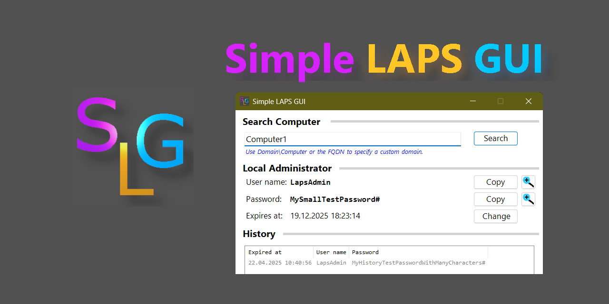

# Simple LAPS GUI  

<!-- Name des Repositories muss immer klein geschrieben werden. -->
  

   

  

A simple and fast GUI for Microsoft LAPS (legacy) and Windows LAPS. With this tool you can query passwords and change the expiration timestamp.

## Features

- Simple and fast: Run the PowerShell script or Batch file, type the computer name and press the ENTER key.
- Supports Microsoft LAPS (legacy) and Windows LAPS on Active Directory environments.
- Query the user name, password and password expiration timestamp of the LAPS account.
- Query the account history of computer objects in your local Active Directory (Windows LAPS only).
- Multi-domain support.
- Copy user names and passwords to the clipboard.
- Zoom view for user name and password with text formatting to distinguish different character groups.
- Change the expiration timestamp.
- Close the window by pressing the ESCAPE key.
- Use Administrative Templates/GPO to configure the app.
- Logging to a file or Windows Event Log.

## Download and Usage

1. Download the archive or setup from [here](http://github.com/htcfreek/SimpleLapsGui/releases).
2. Extract the downloaded archive to your preferred place or install the setup.
3. Run the tool using one of the Batch files or the PowerShell script or desktop shortcuts.

> [!TIP]
> Using a shortcut with the `SimpleLapsGui.ico` from the downloaded zip file shows the correct window icon on your task bar.

> [!NOTE]
> Windows/Smart Screen will warn you on executing the setup that the publisher is not trusted. This is because the files are not digitally signed. The cost for the signing process would be too expensive for an open source project I do not earn money from.

> [!NOTE]
> The uninstaller has a special silent parameter for deleting the Windows Event Log data: `/RemoveEventLog`

### System requirements

- Windows PowerShell 5.1 / PowerShell 7.6 and newer
- Windows LAPS PowerShell module
- Active Directory Domain joined machine and user account
- Optional for changing the timestamp of Microsoft LAPS (legacy) passwords: Microsoft LAPS PowerShell module (AdmPwd module)

> [!TIP]
> In PowerShell 7.6 and newer the zoom view has better Unicode support and text wrapping behavior.

### Permissions

The user account who uses the tool needs the following permissions:

- Read LAPS password attribute(s).
- Decrypt the Windows LAPS password.
- [Optional:] Change expiration time attribute.

> [!CAUTION]
> As always when granting permissions, you should be careful who you grant them to. You should grant permissions only to those who need them (e.g., use administration tiering).

> [!NOTE]
> For more information please read the docs provided by Microsoft:
> - [Windows LAPS permission concept](https://learn.microsoft.com/en-us/windows-server/identity/laps/laps-concepts#user-group-permissions)
> - [Windows LAPS attributes and rights](https://learn.microsoft.com/en-us/windows-server/identity/laps/laps-technical-reference#extended-rights)
> - [Windows LAPS decryption principal](https://learn.microsoft.com/en-us/windows-server/identity/laps/laps-management-policy-settings#adpasswordencryptionprincipal)
> - [Microsoft LAPS attribute permissions](https://techcommunity.microsoft.com/t5/itops-talk-blog/step-by-step-guide-how-to-configure-microsoft-local/ba-p/2806185)

### Configuration of Simple LAPS GUI

The script can be configured by either using the script parameters or the policies from the Administrative Templates. (All configurations are documented based on the latest released version.)

<ins>Script parameters</ins>

All parameter names have to be prefixed with a minus in the command.

|        **Parameter**       | **Possible Values**  | **Default Value** | **Feature**                                                          |
|----------------------------|----------------------|-------------------|----------------------------------------------------------------------|
| CopyLinkTargetsToClipboard |                      | _Not set._        | Links in the app are not opened and instead copied to clipboard.     |
| WindowsEventLogEnabled     |                      | _Not set._        | Enable logging.                                                      |
| LogLevel                   | INFO, WARNING, ERROR | WARNING           | Set the log level.                                                   |
| LogFilePath                | File path.           | _Empty_           | Write the log into a file instead using Windows Event Log as target. |

<ins>Group Policies</ins>

You can get the Administrative Templates as separate downloads or as part of the setup file in the [download area](http://github.com/htcfreek/SimpleLapsGui/releases).

|                 **Name**                | **Feature**                                                          |
|-----------------------------------------|----------------------------------------------------------------------|
| Copy links instead of opening them      | Control how links in the app are handled: Open or copy to clipboard. |
| Enable logging to Windows Event Log     | Enable logging to Windows Event Log and configure log level.         |
| Log to file instead of Windows Eventlog | Write the log into a file instead using Windows Event Log as target. |

### Limitations

- Microsoft Entra ID (Azure AD) is not supported.
- Changing the expiration time of clients that use Microsoft LAPS (legacy) is not supported when searching in multi-domain mode.

## FAQ

**Why did you create another LAPS (G)UI?**

1. The existing standalone LAPS UI doesn't support Windows LAPS and the Windows LAPS password history.
2. There is a built-in Windows LAPS tab in the RSAT (Active Directory Users and Computers). But to use this you have to install the RSAT for everyone who should use it. My GUI is small and portable.
3. The LAPS tab in the RSAT (Active Directory Users and Computers) doesn't show the Windows LAPS password history.
4. When using my GUI you don't have to learn the PowerShell modules.

**Does the script version contains viruses? It is reported on "virustotal.com".**

No it doesn't. Unfortunately some scanners are triggered by PowerShell scripts in a zip file. (Feel free to report the download / script as false positive to the manufacturer of your scanner.)

**Why does Windows / Smart Screen will warn about untrusted publisher?**

This is because the files are not digitally signed. The cost for the signing process would be too expensive for an open source project I do not earn money from.

**Why is there a copilopt-workspace directory? Have you used AI like copilot?**

This folder contains a configuration file that disallows GitHub Copilot to create Issue comments and Pull Requests.

> [!NOTE]
> This tool is developed by me and not by any AI. There was no AI used to create code that is written in this script.

**Can you support Windows Server 2016?**

No. As long as Microsoft doesn't provide the PowerShell cmdlets on Server 2016, I can't support this OS.

> [!WARNING]
> You can find instructions on how to change my script to run on Windows Server 2016. But this is not supported by me. All manipulations of the script happens at your own risk!!!

**Why don't you allow side-loading the LAPS module?**

I know that such a feature would make my script usable on Windows Server 2016. But loading PowerShell modules from unknown locations is a potential security risk. And it requires to lower the execution policy level which is a security risk too.

**How to get the correct window icon shown on my task bar?**

You have to create a shortcut to open the Simple Laps Gui and assign it the `SimpleLapsGui.ico` icon from the downloaded zip file.

**How to configure Simple LAPS GUI?**

You can use the script parameters or Group Policies to configure the app. See the [configuration documentation](#Configuration_of_Simple_LAPS_GUI) for more details.

**Can I configure the tool to copy links instead of opening them?**

Yes this is possible by starting the PowerShell script with the parameter `‑CopyLinkTargetsToClipboard`.

**Why does enabling logging require administrative permissions?**

When logging into Windows Event Log is enabled and the event log category is not created by the installer, it has to be created first by the app. To create a new category in Windows Event Log, administrative permission is required.

**What notations are supported for the computer name?**

The following computer name notations are supported:

- Sam Account Name (begins with a '$")
- Name (for all other inputs)
- DNS Hostname (contains at least one '.' character)
- `<Domain>\<Computer name>`

<!--Source: https://learn.microsoft.com/de-de/powershell/module/laps/get-lapsadpassword?view=windowsserver2022-ps#-identity -->

**How to query an other domain than my computer/user is joined to?**

To do this please use one of the following computer name notations:

- DNS Hostname (contains at least one '.' character)
- `<Domain>\<Computer name>`

**Why are no passwords found?**

Either you don't have the permission to read them or there are no passwords stored for this computer.

**Why do some computers have no history?**

To have a history it must be enabled and the computer must use Windows LAPS.

**Why is the password not decrypted?**

This happens if you don't have the required permission to decrypt the password.

**How can I improve the range of characters supported for account name and password at the zoom view?**

You can try if running the script in PowerShell 7 fixes this. The GUI framework in PowerShell 7 has better Unicode support.

## Support and contributions

If you have any problems or want to suggest a new feature please [fill an issue](https://github.com/htcfreek/SimpleLapsGui/issues/new).

If you want to report a security vulnerability, please use the form on the [SECURITY](https://github.com/htcfreek/SimpleLapsGui/security) page.

Before contributing to this repository please read the [contributing guidelines](/CONTRIBUTING.md)!

## Credits

This repository includes scripts (and other files) that where created while my day to day job work. I want to say thank you to my employer who allows me to share them with you (the community).

## Disclaimer

Product names and company names are trademarks (™) or registered (®) trademarks of their respective holders. Use of them does not imply any affiliation with or endorsement by them.

## License

This Repository is licensed to you under the MIT license. 
See the [LICENSE](LICENSE.md) file in the project root for more information.
